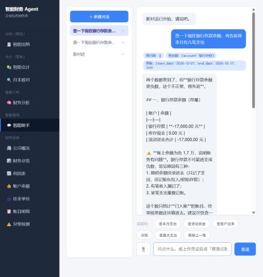
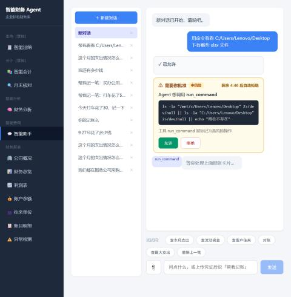

# 企业财务多智能体系统（自研 Agent 运行时）

[](https://github.com/tk-yuan/finance-agent-harness/actions/workflows/ci.yml)


> 一个能真正记账、审核、对账、出报表的财务 Agent 系统——**运行时是从零手写的，没有用 LangGraph**。
>
> 这个仓库要回答的不是「怎么把 LLM 接进来」，而是**一个会动钱的 Agent，怎么能让人敢用**：
> 借贷方向不能靠模型猜、入账必须有人签字、上下文跑长了不能崩、
> 跑一次要能说清它每一步干了什么。

---

## 界面预览

**一个界面，用户同时是使用者也是把关人**——记账、审核、对账、报表、财务分析，都在这里，
对话也在同一个窗口里：



Agent 要碰**工作区之外的东西**（读你的文件、执行命令），卡片会**弹在对话里**，
命令原样显示给你看清楚再决定。批过的卡会留痕：



上图里：第一张卡（`dir /b`）已批准、留了痕迹；第二张卡是 Agent 又想换个路径重试——
**每一次都要单独点**，批过一条不等于放过所有。

跑完之后，Agent 这一趟每一步干了什么，会落成一份 HTML 时间线，从对话里的
「↗ 看它怎么做的」点开就能回看。

---

## 它做什么

给一家小微企业当财务：用户用自然语言说话，Agent 调工具把事办完。

| 场景 | 用户说 | Agent 做什么 |
|---|---|---|
| 出纳 | 「这有张发票，帮我记一下」 | 核验凭证 → `submit_voucher` 登记待审核单据 |
| 会计 | 「把待审核的都过了」 | **只在「📚 智能会计」页做**——逐笔看金额/科目/附件，可改科目、可驳回 |
| 对账 | 「这个月账对不对」 | `reconcile_month` 扫三类异常 + 出当期收支合计 |
| 结账 | 「把这个月封了」 | 查待审核 → 对账 → 核对合计 → `close_period` |
| 全面稽核 | 在「🔍 月末核对」页点「招稽核员做全面稽核」 | **代码直接招只读的常驻稽核员**，把整期账目导成清单交给它，结论回显在页面上 |
| 分析 | 「公司财务健康吗」 | 四角色并行分析 → 汇总报告 |
| 查准则 | 「金融资产公允价值怎么披露」 | `search_accounting_rules` 检索会计准则库 |
| 看凭证 | 「这张发票帮我记一下」 | `read_image` 用视觉模型**读出票面**（金额/日期/对方/商品）→ 再决定科目 |
| 读外面的文件 | 「看看我桌面那份对账单」 | 读工作区外文件（**每次要你授权**）→ 解析后回答 |
| 跑脚本 | 「把这批 Excel 转成 CSV」 | `run_command`（**命令原样给你看，批准了才跑**） |
| 拿不准 | （它自己判断） | `ask_user` 停下来问你，等你答完再继续 |
| 记经验 | 「以后房租都记销售费用」 | `remember` 记一条，**新开对话自动想起来** |

**41 个工具**（21 个只读）、**3 个子 Agent**、**4 个 MCP 工具**、**3 个领域技能**。

## 与 RAG 评测项目的联动

准则检索用的是姊妹项目 `finance-rag-eval` 验证过的配置：
**混合召回（向量 + BM25，RRF 融合）+ 文档级去重**，再做重排。

用那个项目的 400 条评测集在本项目索引上复测（100 条抽样、doc 级金标）：

| 配置 | Recall@1 | Recall@3 | p50 |
|---|---|---|---|
| 向量 + 重排（改造前） | 48.0% | 61.0% | 578ms |
| **混合 + 去重 + 重排（现在）** | **49.0%** | **71.0%** | 642ms |

**Recall@3 +10.0pp，延迟只多 64ms。**
复现：`python scripts/eval_retrieval.py --limit 100 --rerank`。

---

## 快速开始

```bash
pip install -r requirements.txt
cp .env.example .env          # 填入 SILICONFLOW_API_KEY 与 DEEPSEEK_API_KEY

python scripts/serve.py       # 启动，浏览器打开 http://127.0.0.1:8000
```

一个界面，一个进程，一个端口：

| 地址 | 是什么 |
|---|---|
| `/` | **产品界面**：记账 / 审核 / 对账 / 报表 / 财务分析 + 和 Agent 的对话（1733 行的单页应用） |
| `/docs` | 接口文档（FastAPI 自带） |

**Docker 方式**（不用装 Python）：

```bash
docker compose up             # 密钥从宿主机 .env 读
```

### 演示数据：开箱就是一个真在经营的公司

克隆下来不用造数据——仓库自带一份**完整账套**，界面一打开就是满的：
**548 笔已入账单据、跨 12 个月（2025-10 ~ 2026-09）、19 个科目、15 个往来单位**，
收入 660 万 / 支出 654 万。报表、往来余额、月度趋势图都有真实内容。

仓库里有两个账套文件，**用途不同，别搞混**：

| 文件 | 角色 |
|---|---|
| `data/finance.db` | **运行时库**——界面和 Agent 用的就是它，会被读写（记账、结账都会改它） |
| `data/eval_ledger.db` | **评测专用的冻结副本**——科目判定那组数字跑在它上面。单独留一份是为了：你在界面上随便玩、改了演示账套，评测数字照样复现 |

`FIN_DB_PATH` 环境变量可以指到别的库（`.env` 里改），想拿自己的账套试也方便。

---

## 端到端实跑

真实调用（`deepseek-chat`），用户问：

> 查一下现在银行存款余额，再告诉我本月有几笔支出

Agent 的**完整执行链路**（跑完从对话里的「↗ 看它怎么做的」打开）：

```
turn1  工具 ×2   get_current_time{} / get_account_balance{account: 银行存款}
turn2  工具 ×1   query_entries{start_date: 2026-10-01, end_date: 2026-10-31, ...}
turn3  工具 ×0   → 收工，3 轮完成
```

结论（数字全部来自工具返回，与 `/api/v1/stats/*` 接口一致）：

- 银行存款 **-17,000.00 元**（负数，账上只有支出没有进账）
- 本月支出 **2 笔，合计 17,000.00 元**（办公费 5,000 + 房租 12,000）
- 并主动指出：余额为负不正常，列出三种常见原因，建议做一次月度对账

**上下文随轮次增长**（1,475 → 1,816 → 2,689 字符），说明历史正确累加了——
这一点是这个项目踩过坑之后才修对的，见下文「设计取舍」。

---

## 实测结果：两个业务数字

### 一、会计科目判定准确率 99.4%（对照基线 83.0%）

机制能被单测证明"没坏"，但证明不了"有用"。这个数字回答的是后者。

**数据**：一份真实账套（548 条已入账单据、跨 12 个月、19 个科目）。
**抽样**：按科目均衡抽，14 个科目各最多 15 条 → **165 张单据 / 50 类业务摘要**。
**做法**：遮住科目，只给「收付方向 + 摘要 + 金额 + 账户」，让系统判。

| | 准确率 | 说明 |
|---|---|---|
| **本系统** | **99.4%** | 164/165 张单据 |
| 按摘要去重 | **98.0%** | 49/50 类业务摘要 |
| 关键词规则基线 | **83.0%** | 137/165 |
| 提升 | **+16.4pp** | |

基线不是稻草人——它按「房租 / 差旅 / 招待 / 水电…」这类关键词写，
**是我照着"一个懂点会计的人会写的规则"写的**。
在全量数据上它能到 92%，一换成按科目均衡抽样就掉到 83%：
**同质数据会掩盖基线的短板，这正是要做均衡抽样的原因。**

唯一判错的一条：`紧急采购-天津港进口贸易公司`，金标「办公费」→ 判成「其他」。
这条本身就有解释空间（紧急采购既可入办公费、也可入其他费用），属于口径分歧而非硬错。
逐条明细见 `reports/account_mapping_eval.json`。

**口径与边界**（写在这里，不藏在结论后面）：
- 金标来自账套自身。账套是照着《小企业会计准则》的业务场景构造的，**不是注册会计师逐条标注的**。
- 只测系统支持的收付方向，结算/结转类 88 条排除；2 类摘要对应多个科目，已排除。
- 复现：`python scripts/eval_account_mapping.py 15 --ledger <账套路径>`

### 二、内控拦截率 13/13

一个会动钱的 Agent，边界守没守住，得**真的去试**，而不是读代码判断。
每条都是一次真实调用（走工具层），断言它被拒绝：

| 违规操作 | 结果 |
|---|---|
| 无凭证记账（未提供凭证 / 文件不存在） | ✓ 拦住 |
| 金额为 0 / 为负数 | ✓ 拦住 |
| 非法收付方向 | ✓ 拦住 |
| 入账用科目表外的科目 | ✓ 拦住 |
| 对已入账单据重复入账 | ✓ 拦住 |
| 撤回已入账单据 | ✓ 拦住 |
| 驳回不写理由 | ✓ 拦住 |
| 对已结账期间再结账 | ✓ 拦住 |
| 待审核队列非空时结账 | ✓ 拦住 |
| 写入白名单之外的路径 | ✓ 拦住 |
| **审批被拒时高风险工具不执行** | ✓ 拦住 |

**内控拦截率 13/13 = 100%**。最后一条尤其关键：它不看返回值，
而是走运行时的真实路径——装配 harness、挂一个拒绝审批门、真的调 `post_voucher`，
确认工具**没有被执行**。单测里各部件都通过、连起来却照样把账记了，
是这类系统最典型的翻车方式。

复现：`python scripts/audit_controls.py`（审计跑在临时账套副本上，不碰演示数据）

---

## 架构

```
                    ┌─────────────── 入口层 ───────────────┐
  产品界面 /  ──────▶│  FastAPI + ASGI                      │
                    │  /api/v1/*  业务接口（10 个路由模块） │
                    │  /api/v1/chat  对话（提交任务拿 run_id）│
                    │  /runs/{id}/events  SSE 实时事件流    │
                    └───────────────┬──────────────────────┘
                                    │
                    ┌───────────────▼──────────────────────┐
                    │           主循环 loop.py              │
                    │  组装提示 → 调模型 → 执行工具 → ...    │
                    └───┬──────────┬──────────┬────────────┘
                        │          │          │
              ┌─────────▼──┐  ┌────▼─────┐  ┌─▼──────────────┐
              │ 工具池 41 个│  │ 四节点    │  │ 上下文         │
              │ 权限 / 审批 │  │ Hook     │  │ 压缩 + 分层记忆 │
              └────────────┘  └──────────┘  └────────────────┘
                        │          │          │
              ┌─────────▼──────────▼──────────▼────────────────┐
              │  子 Agent 委派 · Agent Teams · 后台任务 · cron   │
              └────────────────────────────────────────────────┘
```

### 四节点 Hook：能力靠中间件长出来，不改主循环

| 节点 | 挂什么 |
|---|---|
| `before_model` | 组装系统提示（技能目录 + 任务清单 + 记忆）→ 上下文压缩 → 注入队友回报与后台通知 |
| `after_model` | 用量统计 |
| `before_tool` | 权限校验 → **人工审批门** → 缓存命中短路 → 重试策略 → PII 检测 |
| `after_tool` | 超长结果落盘，上下文只留摘要与路径 |

主循环里**一行 `if` 都没为这些能力加过**。想加新机制就注册一个 hook，不改 loop.py。

### 虚拟文件系统

Agent 能操作的不是整个磁盘，是 7 个语义目录，且权限按目录分级：

| 目录 | 用途 | 可写性 |
|---|---|---|
| `vouchers/` | 出纳提交的原始单据 | 可改可撤 |
| `archives/` | 已审核入账的凭证、已结账期间 | **只增不改** |
| `reports/` | 报表与分析报告 | 可写 |
| `artifacts/` | 超长工具结果的落盘位置 | 运行时写 |
| `logs/` `rules/` `memories/` | 执行日志、企业私有规则、经验沉淀 | 可写 |

`vouchers/` 可改而 `archives/` 不可改——**这个区分才是分目录的理由**。
都在一个大 workspace 里的话，权限就只剩"能写/不能写"一个粒度。

---

## 内控与授权：Agent 能碰什么，谁说了算

### 先分清两类：**授权** vs **工序**

这是本项目最容易做错、也最值得说清的一条分界：

| | 例子 | 在对话里怎么处理 |
|---|---|---|
| **授权类** | 跑命令、读写工作区外的文件、看凭证 | **弹卡问你就行**——它要的是一次许可，没有"工序"可言 |
| **工序类** | **入账**、驳回、改科目 | **不在对话里办**，直接拒并把人指到「📚 智能会计」页 |

**为什么入账不能做成"点一下允许"**：那等于把审核降级成一个按钮。
审核人根本看不到金额对不对、科目定得对不对、附件是哪一张——
而这些恰恰是会计要在「智能会计」页逐笔看的（那里能改科目、能驳回，走的是真实工序）。

**记账必须过审核，这条线不能有快捷方式。** 所以 Agent 登记完只会说
"这笔记的是**待审核**状态，请到智能会计页面审核"，**不许说"已经记好了"**——
提示词里写死了，`tests/test_approval.py` 也断言了。

实测（Agent 被要求直接入账时）：

> 我不能直接入账。这不是我推诿，是内控上必须守的一条线……
> 而且您这句"科目记办公费"我也不能照办：**科目得看凭证上写的是什么**。
> 没看凭证就定科目，是这一行最不能犯的错。

### 三类"弹卡要你处理"的动作

| 动作 | 为什么 |
|---|---|
| `run_command`（执行命令） | 会动到本机。命令**原样展示**，看清楚再决定 |
| 读写工作区外的文件 | 就是一次授权；批过的路径本次记住，换个路径重新问 |
| `ask_user`（Agent 主动提问） | 账套和准则都定不了时，问一句比让模型掷硬币强。**有选项就渲染成可点的按钮**（也永远允许你自己写） |

**为什么是阻塞而不是"先做着，回头补批"**：有后果的动作不能先做了再补审批。
超时会自动拒绝，而不是默认放行——而且**倒计时显示在卡片上**，
"它会超时"这件事本身要让人看得见，否则就是突然失败。

### 文件访问：免问区 + 逐次授权

`workspace/`、`data/` 是本项目自己的地盘，随便读写。**碰区外的文件**
（你桌面上的 Excel、客户发来的对账单），**每次都要你点"允许"**；
批过的路径本次进程内记住，不重复烦你——但换个路径就得重新问。

改这条规则之前是"越界一律拒绝"。那条规则安全，但让 Agent 残废：
用户问"看看我桌面那份表"，它只会回一句"路径越界"，一点忙帮不上。
**可用的边界不是"绝对不许"，而是"每次都要人明确同意"**——跟 Claude Code 是同一个模型。

### 卡片弹在哪：就在对话里

聊天接口是**异步**的（提交任务 → SSE 推事件），所以 Agent 能真的停下来等人。
审批卡、授权卡、提问卡都直接出现在对话中，**批过拒过都留痕**，一眼看得出这一趟发生过什么。

**为什么不做成同步一问一答**：HTTP 请求不能挂着等几分钟。
旧的网页聊天因此只能"遇到高风险动作就拒绝"，把 Agent 阉割成只会动嘴的顾问。
现在它会停下来问——**同一个 Agent，只是终于能用上完整的能力了**。

### 同一套机制的另一种用法：Agent 主动提问

`ask_user` 让 Agent 能**在半路停下来问人**——「这笔采购算办公费还是主营业务成本？」
这类问题账套里查不到、准则也定不了，正确答案就是问一句，而不是让模型掷硬币。

它和审批**共用同一个阻塞门**，因为底层动作完全一样（停 → 推 → 等 → 继续），只是载荷不同：

| | 审批 | 提问 |
|---|---|---|
| 人给什么 | **否决权**（批准 / 拒绝） | **信息**（一段文本） |
| 超时怎么办 | 按拒绝处理 | 返回空回答，由工具降级成"请自行合理假设并标注" |
| 谁发起 | 中间件按规则拦下 | Agent 自己判断需要 |

**为什么要刻意分成两种而不是合一个**：批准这个动作必须永远只有二值语义，
不能被一段自由文本污染。所以 `resolve()` 里提问走 `answer`、审批走 `approved`，两条路分开。

**没挂门时一律降级**（CLI 单跑、单元测试）：工具**照样注册**，调用返回
"当前没有可交互的用户，请合理假设并标注"——注册不依赖 gate，
否则线上和测试环境的工具池形状就不一样了，接线测试也就失去意义。
这些都在 `tests/test_approval.py` 与 `tests/test_fs_approval.py` 里锁住了。

这套约束不只是提示词里的规矩，`tests/test_ledger_controls.py` 直接断言：
无凭证不许记账、金额必须大于 0、借贷方向由代码算、高风险工具必须标记审批。

---

## 与教程 s01–s17 的对应

运行时补齐了 [learn-claude-code](https://github.com/) 全套机制：

| 讲 | 机制 | 状态 |
|---|---|---|
| s01–s04 | 主循环 / 工具池 / 权限 / 四节点 Hook | ✅ |
| s05–s10 | 任务状态机+依赖图 / 子 Agent / Skills / 上下文压缩 / 分层记忆 | ✅ |
| **s11** | **后台任务**（全量稽核、年度报表，不阻塞主对话） | ✅ |
| **s12** | **cron 调度**（每日巡检、月度结账提醒，同分钟内 tick 幂等） | ✅ |
| **s13** | **Agent Teams**（持久队友 + 消息总线 + 共享任务板） | ✅ |
| s14 / s16 / s17 | MCP / Workflow / 目标闭环 | ✅ |

**「子 Agent」和「队友」的区别**（s10 vs s13）：

| | 子 Agent | 队友（Teams） |
|---|---|---|
| 生命周期 | 一次调用后结束 | WORK → IDLE → WORK，常驻 |
| 派活 | 主 Agent 逐个委派 | **空闲队友自己认领** |
| 通信 | 返回一次结论 | **双向**（文件收件箱） |
| 上下文 | 只服务一个任务 | **跨任务保留** |

领域侧配了三个子 Agent：`rule_researcher`（查准则）、`ledger_auditor`（稽核账目）、
`finance_analyst`（财务分析）。

**角色只定义一份，部署形态有两种**：岗位职责集中在 `domain/roles.py`
（研究员 / 稽核员 / 分析师 / 出纳 / 会计），子 Agent 和队友共用同一份，
只是套上不同的"接活与回报方式"（一次性委派 / 常设岗位）。
所以不存在两份稽核员——临时核一笔用 `task` 派子 Agent，一步完事；
月末结账前的全面稽核这类反复、跨轮次还要记得查过什么的活，才招常驻队友（走人工审批）。

**产品入口**：「🔍 月末核对」页有一个「招稽核员做全面稽核」按钮——
代码直接招募只读的 `auditor_wang` 并派活，不经过模型判断；
对话里的委派仍由模型按提示词自行决定。

---

## 工程质量

```bash
python -m pytest tests/ -q     # 168 个单元测试，全离线，不需要 API key
```

覆盖运行时（主循环 / 并行工具 / 上下文压缩 / 分层记忆）、中间件（缓存 / 重试 / PII）、
审批门、存储层、会话、接线检查，以及财务域的内控约束。

**接线检查值得单说**：它用反射遍历 41 个工具，比对 schema 声明的参数名与处理函数的签名。
这类 bug 不报语法错、不报导入错，只在模型真正调用时才炸——
本项目就踩过「工具名对得上但参数名对不上」的坑，于是写了这个测试。
它上线后立刻抓到一个真 bug：`close_period` 的 `period` 声明必填、实现却有默认值。

**CI 跑什么**：单元测试 → 装配冒烟（37 工具 / 3 技能 / 3 子 Agent / 4 MCP 都能拼起来）
→ 路由检查（业务接口与运行时接口确实挂在同一个 app 上）。

**回归测试**：`regression/` 里把执行链路的 JSON 固化成可断言场景，防止改动让 Agent 悄悄退化。

---

## 设计取舍

详见 [docs/DESIGN.md](docs/DESIGN.md)、[docs/GLOSSARY.md](docs/GLOSSARY.md)、[docs/LEARNING.md](docs/LEARNING.md)。几条最值得说的：

- **手写运行时，不用 LangGraph**。不是为了重复造轮子，是因为要能把"运行时到底怎么转"讲清楚——
  审批为什么阻塞、上下文怎么压、队友和子 Agent 差在哪。用框架这些都被封装掉了。
- **借贷方向不交给 LLM**。`make_entries()` 是纯函数，按收付方向和科目算出借贷两边。
  这是财务领域最容易做错、也最不能交给模型的一步——**方向错了，金额再对凭证也是废的**。
- **日期不让模型猜**。`_today()` 由代码给出。让 LLM 说"今天是几号"是不可接受的。
- **业务层一行没改**。换运行时的时候，`services/` 和 `api/` 是按 pydantic-settings 写的，
  只加了一个同形状的配置适配器，业务代码零改动——**这是分层的价值，不是巧合**。
- **缓存 harness，但每次对话换一份 trace**。记忆和任务板要跨轮保留（所以缓存），
  但 trace 必须一次一份，否则界面上会显示上一轮跑过的工具。

### 一个踩过的坑，留在这里当教训

加上 Agent Teams 之后，`before_model` 里多了一段注入队友回报的代码，写成了：

```python
if team is not None:
    msgs = team.consume_results()     # ← 覆盖了累积的对话历史
```

`team` 一直非空，`consume_results()` 多数时候返回空列表，于是 **`msgs` 每轮都被清空**。
表现极具迷惑性：Agent 不报错，只是每轮重复同样几个探索性调用，直到跑满 40 轮，
最后返回一句"我先了解一下当前情况"。

诊断方法是把**实际发给模型的消息**打出来——发现每轮只有 1 条 `system`，
上下文恒为 1546 字符。修掉之后：**3 轮完成、4.4 秒**。

**教训**：Agent 的失效往往不报错，只表现为"回答得很敷衍"。
**链路追踪不是锦上添花，是唯一能看见真实原因的地方**。

---

## 文档

| 文档 | 内容 |
|---|---|
| [docs/DESIGN.md](docs/DESIGN.md) | 设计取舍：为什么这么分层、审批为什么阻塞、上下文怎么压 |
| [docs/GLOSSARY.md](docs/GLOSSARY.md) | 术语表：Hook / 子 Agent / Teams / 记忆分层…… |
| [docs/LEARNING.md](docs/LEARNING.md) | 教学指南：这个运行时是怎么一步步长出来的 |

## 测试

```bash
python -m pytest tests/ -q         # 168 个单元测试
python scripts/serve.py            # 起服务，用界面走一遍
```
